## HCP Terraform VCS Workflow with Gitlab, OIDC and OPA Policy


#### code push to gitlab then pull request/merge request ,  for first time, need to run manual in HCP then Automatic speculative plans run, if that workfolw is ok, need to merge in gitlab then plan and apply automatically run in HCP and create resources in AWS

```
Code Push to GitLab ➔ Open Merge Request (Triggers Automatic Speculative Plan & OPA Check in HCP Terraform) ➔ Merge Code ➔ Triggers Automatic Plan & Apply via OIDC to Create AWS Resources
```

https://gitlab.com/haymannko/vcs-workflow-with-oidc-and-opa-policy-hcp-remote-execution.git


### Protected Branch
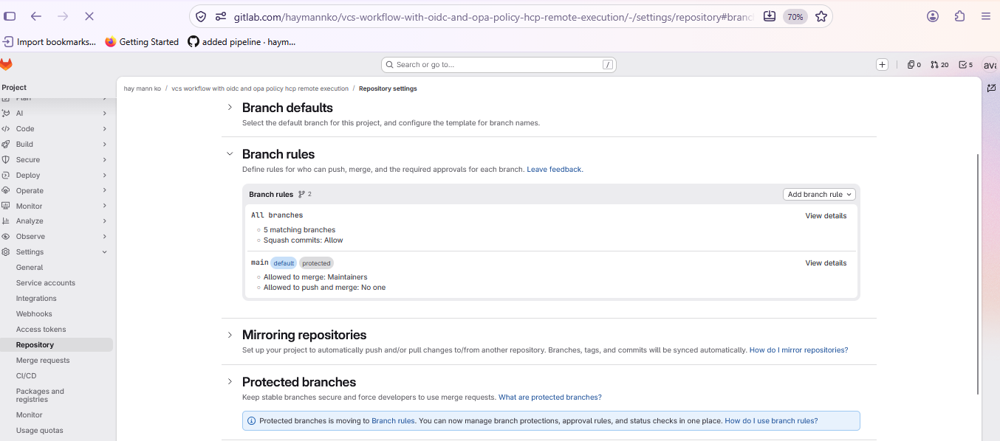

### Webhooks
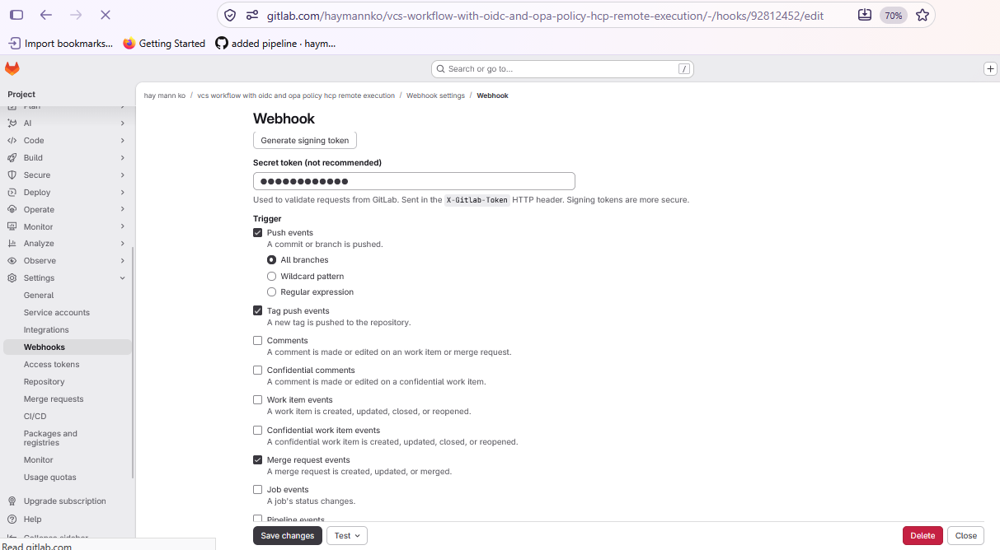


### workspace setting
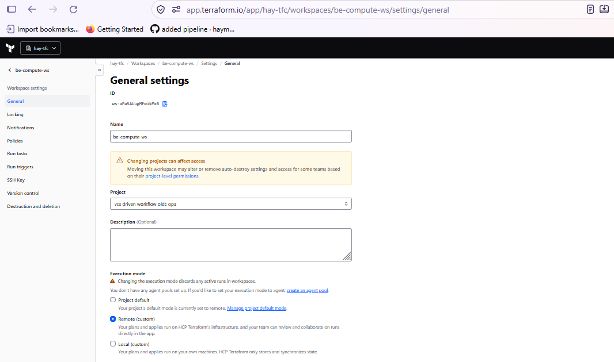

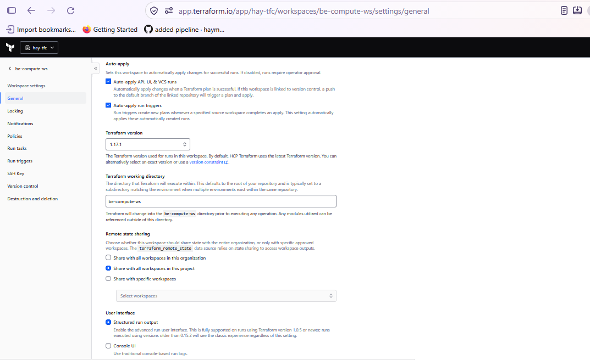

### Version Control
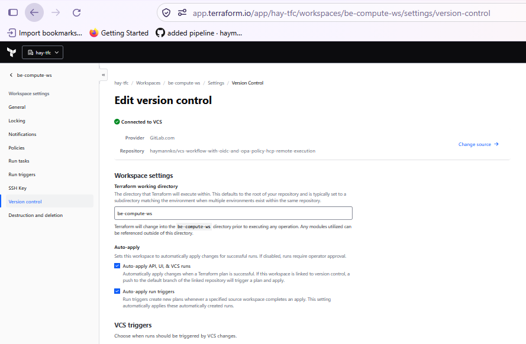

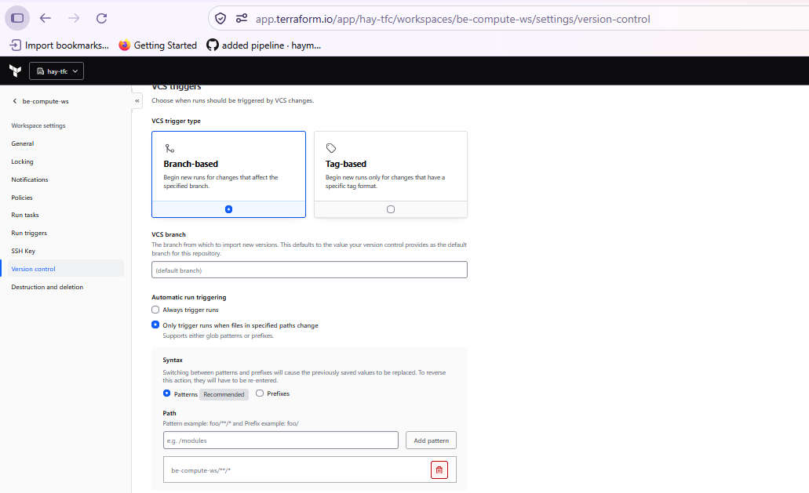

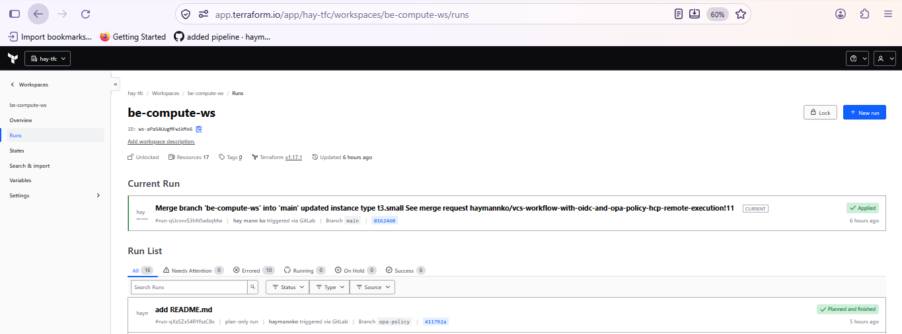

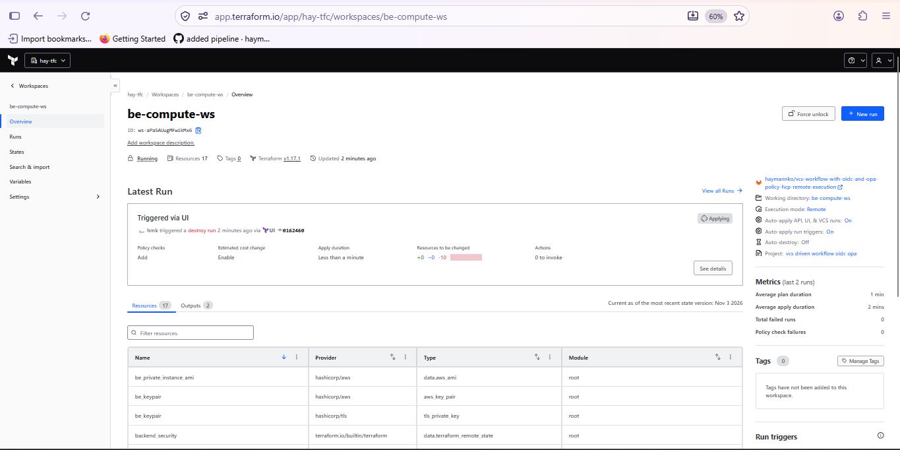

### OIDC
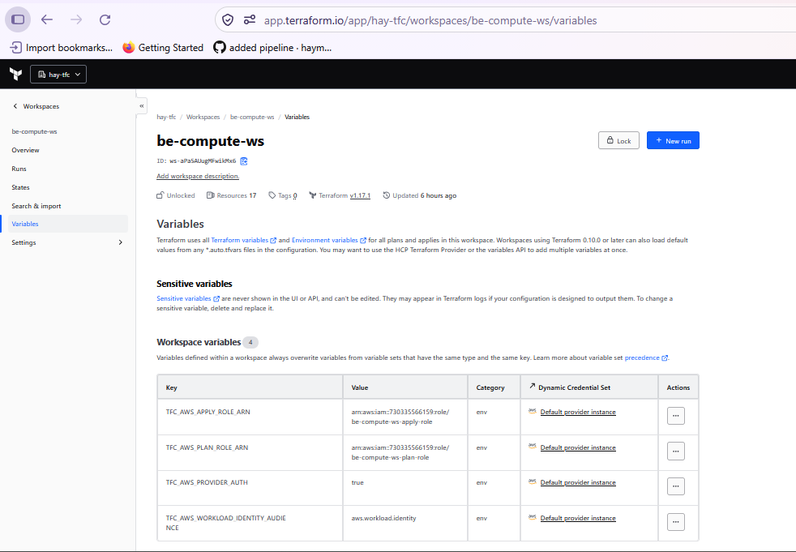

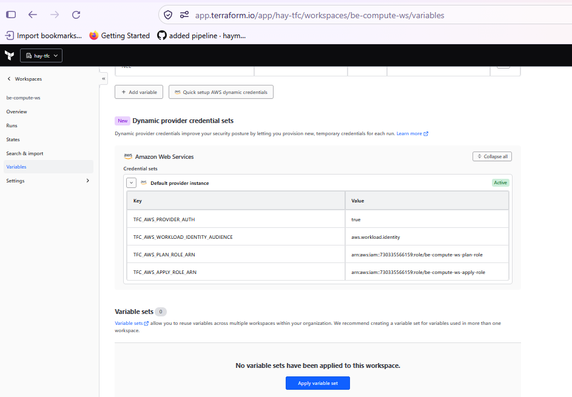

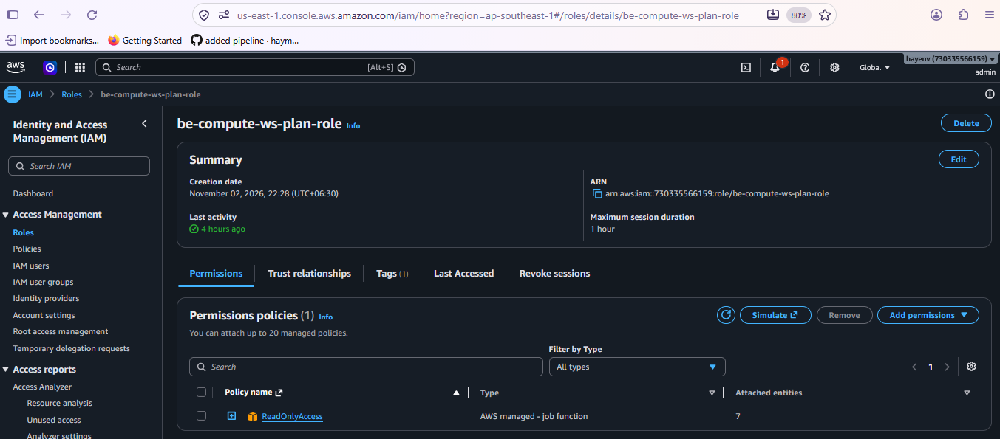

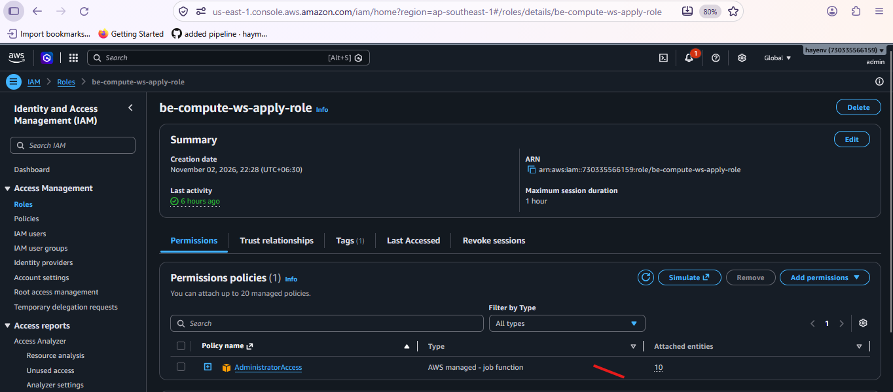

### OPA Policy (public-ingress-deny-policy)
```
package terraform.policies.public_ingress

import input.plan as plan

deny contains msg if {
  r := plan.resource_changes[_]
  r.mode == "managed"
  r.type == "aws_security_group"
  r.change.after.ingress[_].cidr_blocks[_] == "0.0.0.0/0"
  msg := sprintf("%v has 0.0.0.0/0 as allowed ingress", [r.address])
}
```


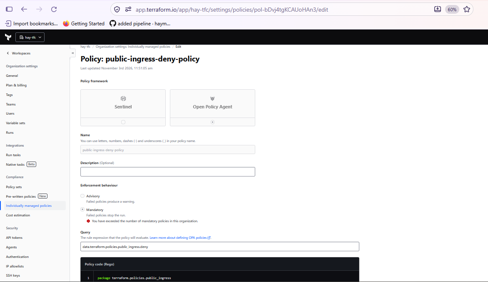

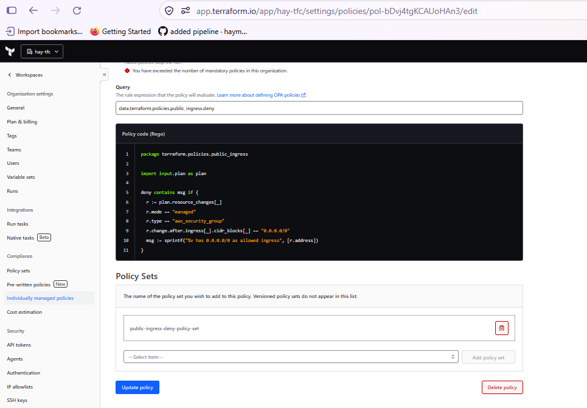

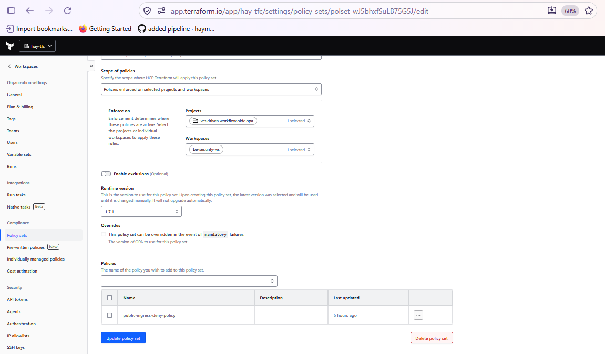


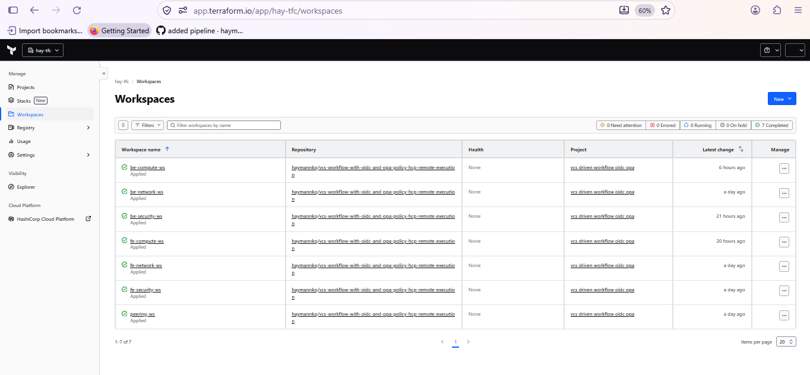

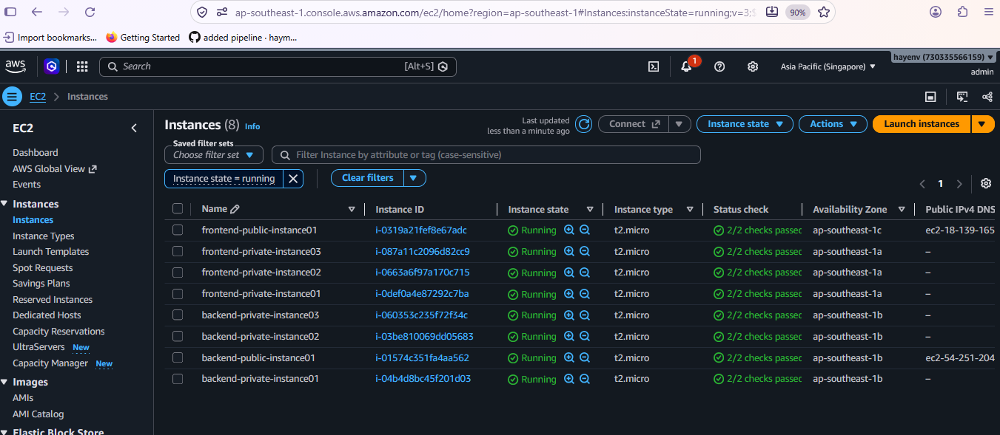

### Donot forget to destroy
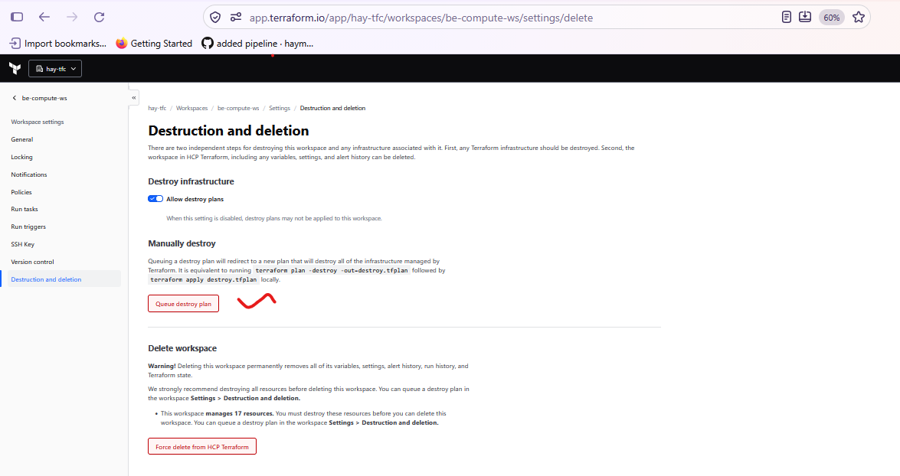